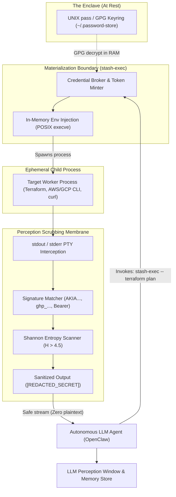
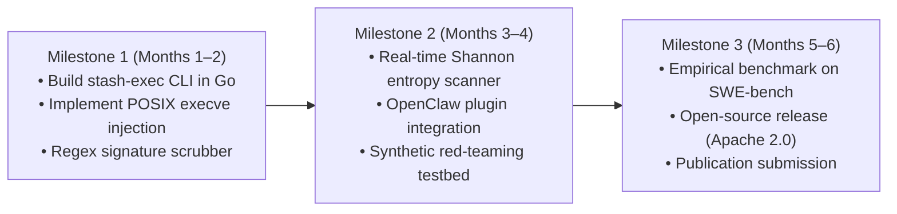

# High-Level Design (HLD) — Track 1: Agentic Runtime Credential Containment & Perception Scrubbing Membrane

## Google AI for Privacy, Safety & Security (PSS) Award Track

- **Project:** Stash House V2 — Track 1 (`stash-exec`)
- **Document Version:** 2.0.0-Track1
- **Date:** 2026-11-20
- **Author:** Franklin Diaz (`franklin@bitsmasher.net` / `franklin.diaz@ucdenver.edu`)
- **Affiliation:** University of Colorado Denver / Bitsmasher Labs
- **Target Grant:** Google AI for Privacy, Safety & Security (PSS) Award ($100,000 unrestricted research gift)

---

## 1. Executive Summary & Strategic Positioning

Autonomous LLM agents (e.g., OpenClaw, AutoGPT, Claude Code) interact with system runtimes by generating shell commands, spawning execution processes, and consuming returned standard input/output streams. Unlike human developers who visually filter sensitive data, autonomous agents process raw terminal outputs directly into their prompt context windows.

This design presents **Track 1 of Project Stash House**: a lightweight, host-level containment harness and perception membrane specifically engineered to prevent autonomous AI agents from leaking runtime credentials into conversational contexts, persistent vector memories, and session logs.

By shifting credential security from enterprise identity federation to **runtime perception boundaries**, Track 1 directly targets Google's primary priority in **"Mitigating Adversarial Usage of AI"** and **"Improving AI Safeguards."**

---

## 2. Threat Model: The Agentic Credential Exposure Attack Surface

When an autonomous agent operates on an engineering workstation (e.g., `chonk.lab.bitsmasher.net`), ambient credentials (such as environment variables, AWS profiles, and service account tokens) are vulnerable to four failure modes:

```text
┌─────────────────────────────────────────────────────────────────────────────┐
│                   Track 1 Agentic Threat Exposure Vectors                   │
├───────────────────────────────┬─────────────────────────────────────────────┤
│ 1. Context Window Ingestion   │ Verbose CLI stack traces (curl, Terraform)  │
│                               │ or raw `env` commands echo live tokens      │
│                               │ directly into LLM prompt attention context  │
├───────────────────────────────┼─────────────────────────────────────────────┤
│ 2. Memory & Reflection Sprawl │ Ephemeral secrets are committed to daily    │
│                               │ session logs, trajectory databases, and     │
│                               │ vector stores (~/.openclaw/memory/daily/)   │
├───────────────────────────────┼─────────────────────────────────────────────┤
│ 3. Scratchpad Persistence     │ Agents author temporary scripts in scratch/ │
│                               │ or staging/ directories, hardcoding keys or │
│                               │ leaving unencrypted dotenv files on disk    │
├───────────────────────────────┼─────────────────────────────────────────────┤
│ 4. Indirect Prompt Injection  │ Untrusted web content or third-party repos  │
│                               │ manipulate the agent into dumping ambient   │
│                               │ environment variables to remote endpoints   │
└───────────────────────────────┴─────────────────────────────────────────────┘
```

### The Invariant: The Zero-Agent-Read Principle

> The autonomous agent must never possess direct read or decryption access to plaintext secrets. Authority must be conferred in-memory strictly at the moment of child process execution and redacted from all perceptual feedback channels.

---

## 3. Track 1 System Architecture

Track 1 isolates the agent perception layer using a two-sided broker: in-memory process execution on the invocation side, and stream redaction on the perception side.



### Component Breakdown

1. **`stash-exec` Wrapper:**
   - Intercepts target tool calls from the agent runtime.
   - Retrieves secrets via GPG without persisting unencrypted intermediate files.
   - Spawns the child worker via `execve`, passing credentials strictly in process memory.
   - Disables command argument logging (`ps aux`) and shell history recording.
2. **Context Scrubbing Membrane:**
   - Attaches a pseudoterminal (PTY) or pipe to child process `stdout` and `stderr`.
   - **Signature Matcher:** Regex classification targeting structured tokens (Google Cloud service account keys, GitHub PATs, AWS access keys, JWTs).
   - **Shannon Entropy Scanner:** Evaluates running character entropy ($H = -\sum p_i \log_2 p_i$) on unstructured alphanumeric strings, flagging high-entropy substrings ($H \ge 4.5$).
   - Replaces all identified secrets with `[REDACTED_SECRET]` in real time.
3. **Workspace Invariant Guardrails:**
   - Pre-commit and pre-execution linters abort tasks attempting to author `.env` or `credentials.json` files in workspace scratch directories.

---

## 4. Google AI PSS Award Alignment & Research Agenda

Google’s AI PSS program requires rigorous AI/ML-centered research questions paired with open-source engineering outcomes.

### Core Research Questions (RQs)

1. **RQ1 (Empirical Leakage Modeling):** Across standard multi-hop developer benchmarks (SWE-bench, GAIA), what percentage of unconstrained agent runs inadvertently leak live credentials into conversational transcripts and error logs?
2. **RQ2 (Entropy Redaction Latency Trade-offs):** Can real-time Shannon entropy filtering achieve $>98\%$ recall on unstructured secret strings while maintaining stream latency overhead $<15$ ms?
3. **RQ3 (Downscoped Resilience):** How do autonomous agents adapt when injected tokens expire mid-task, and can autonomous token refresh be negotiated without exposing root master keys?

### Quantitative Evaluation Plan

| Metric | Target | Evaluation Method |
| :--- | :--- | :--- |
| **Leakage Prevention Rate (LPR)** | **100%** | Simulated red-team prompt injections attempting environment variable exfiltration. |
| **Stream Latency Overhead** | **$< 15$ ms** | Benchmark PTY stream throughput on high-output CLI tasks (compilation, terraform plans). |
| **Scrubbing Recall** | **$> 98.5%$** | Tested against the SecretBench corpus and synthetic high-entropy key datasets. |
| **False Positive Rate** | **$< 0.5%$** | Validated against base64-encoded binary assets, git commit hashes, and UUIDs. |

---

## 5. Implementation Roadmap & Milestones



### Deliverables

- **`stash-exec`:** Standalone cross-platform binary (Go) for Linux and macOS.
- **`agent-membrane`:** Python and Go library for terminal stream secret redaction.
- **Trace Corpus:** Annotated open dataset of agent tool executions measuring credential leakage patterns.
- **Google Research Whitepaper:** Formal grant final report and conference submission (e.g., USENIX Security / IEEE S&P).
