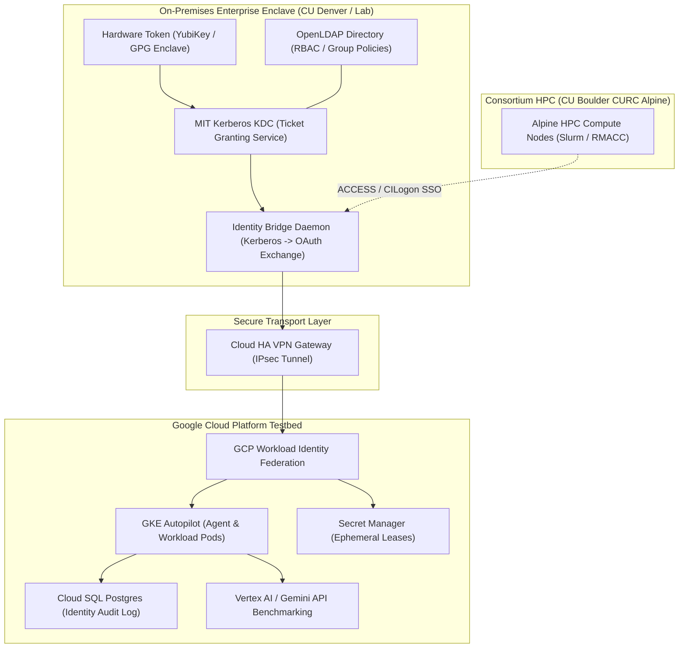
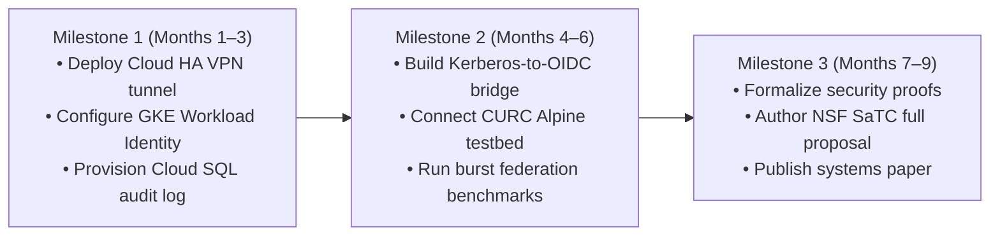

# High-Level Design (HLD) — Track 2: Enterprise Identity Federation & The Materialization Boundary

## NSF SaTC Core & GCP Cloud Infrastructure Track

- **Project:** Stash House V2 — Track 2 (`identity-bridge`)
- **Document Version:** 2.0.0-Track2
- **Date:** 2026-11-20
- **Author:** Franklin Diaz (`franklin@bitsmasher.net` / `franklin.diaz@ucdenver.edu`)
- **Affiliation:** University of Colorado Denver / Bitsmasher Labs
- **Target Grants:**
  - NSF Secure and Trustworthy Cyberspace (SaTC) Core Programs ($600K–$1.2M)
  - Google Cloud Platform (GCP) Research Credits Program ($5,000.00 non-monetary cloud allocation)

---

## 1. Executive Summary & Strategic Positioning

Modern research and enterprise computing environments operate across hybrid topologies spanning on-premises directory infrastructure, university HPC clusters (e.g., CU Boulder CURC Alpine), and public cloud platforms (Google Cloud Platform). When automated workflows, CI/CD runners, and autonomous agent daemons execute across these distributed domains, authority is routinely delegated via static long-lived API keys, unrotated service account JSON files, and hardcoded secrets.

**Track 2 of Project Stash House** formalizes the **Materialization Boundary**: an enterprise-grade identity federation architecture that bridges on-premises authority roots (MIT Kerberos and OpenLDAP) to cloud-native orchestrators (Google Kubernetes Engine, Cloud HA VPN, Secret Manager).

Rather than focusing on individual terminal output scrubbing, Track 2 addresses **systemic authority delegation, cryptographic attestation, and non-repudiable identity federation** across distributed hybrid infrastructure.

---

## 2. Threat Model: Enterprise Authority Delegation Across Hybrid Topologies

The enterprise threat model considers an adversary who achieves code execution or compromised credentials on a developer workstation or agent node. Under conventional architectures, such a compromise grants lateral access across connected cloud environments:

```text
┌─────────────────────────────────────────────────────────────────────────────┐
│                   Track 2 Enterprise Hybrid Threat Vectors                  │
├───────────────────────────────┬─────────────────────────────────────────────┤
│ 1. Static Service Account     │ Cloud IAM JSON keys stored on disk provide  │
│    Key Exfiltration           │ perpetual, unmonitored backdoor access      │
├───────────────────────────────┼─────────────────────────────────────────────┤
│ 2. Lateral Cloud Privilege    │ Compromised CI/CD or agent runner on-prem   │
│    Escalation                 │ leverages over-privileged static API tokens │
├───────────────────────────────┼─────────────────────────────────────────────┤
│ 3. Broken Provenance & Audit  │ Shared automated credentials obfuscate      │
│    Repudiation                │ which specific human, agent, or task acted  │
├───────────────────────────────┼─────────────────────────────────────────────┤
│ 4. Hybrid Boundary Drift      │ On-premises Kerberos/LDAP identity changes  │
│    & Delayed Revocation       │ fail to immediately propagate to cloud IAM  │
└───────────────────────────────┴─────────────────────────────────────────────┘
```

### The Invariant: Hardware-Rooted Ephemeral Delegation

> All cloud authority must be derived dynamically from hardware-backed or enterprise-attested Kerberos ticket-granting infrastructure. No persistent cloud credentials may reside on developer workstations or edge compute nodes.

---

## 3. Track 2 System Architecture

Track 2 implements an automated **Identity Bridge** connecting local campus enterprise directory services to cloud-native workload identity pools via dedicated encrypted tunnels.



### Architectural Pillars

1. **Enterprise Kerberos-to-Cloud Bridge Daemon:**
   - Evaluates Kerberos Ticket Granting Tickets (TGTs) presented by authenticated users or daemons.
   - Exchanges Kerberos tickets for short-lived, downscoped Google Cloud OAuth 2.0 / STS tokens via OpenID Connect (OIDC) federation.
2. **Cloud HA VPN Site-to-Site Tunnel:**
   - Provides redundant, encrypted IPsec tunnels between the on-premises university lab (`10.0.0.0/16`) and the Google Cloud Virtual Private Cloud (`172.16.0.0/16`).
   - Ensures identity federation requests never transit the public internet unencrypted.
3. **GKE Workload Identity Federation:**
   - Binds Kubernetes Service Accounts (KSA) directly to Google Cloud IAM Service Accounts (GSA), eliminating Kubernetes secret storage for containerized workloads.
4. **Non-Repudiable Cryptographic Audit Ledger:**
   - Every token materialization event is cryptographically signed and recorded in Cloud SQL Postgres with HMAC metadata, linking each cloud API call to an attested on-prem Kerberos principal.

---

## 4. NSF SaTC Core & GCP Research Credits Alignment

Track 2 serves as the core infrastructure and experimental testbed for major federal and institutional grant applications.

### NSF SaTC Alignment

- **Program:** NSF Secure and Trustworthy Cyberspace (CISE/CNS).
- **Core Research Theme:** Trustworthy Systems Architecture and Zero-Trust Cloud Federation.
- **Research Questions:**
  1. **RQ1 (Byzantine Node Isolation):** Can a cryptographic materialization boundary provably prevent lateral privilege escalation when an intermediate worker node is fully compromised by an adversary?
  2. **RQ2 (Federation Latency at Scale):** What are the throughput limits and scaling bottlenecks of dynamic Kerberos-to-OIDC token exchanges during burst compute scheduling (e.g., 500+ container nodes on Alpine/GKE)?
  3. **RQ3 (Tamper-Evident Agent Provenance):** How can zero-knowledge proofs or HMAC chains guarantee non-repudiation in multi-agent pipelines without degrading execution speed?

### GCP Research Credits Allocation ($5,000.00)

Track 2 leverages the approved $5,000.00 GCP credit budget (aligned with Google's faculty award ceiling) routed via the CU Denver Research Development Office (Stefan Reiss):

| GCP Component | Resource Allocation | Role in Research |
| :--- | :--- | :--- |
| **GKE Autopilot** | 32 vCPU / 128 GB pool | Hosts experimental multi-user identity bridge and agent workloads |
| **Cloud HA VPN** | Dual-tunnel 99.99% SLA | Site-to-site encrypted transport connecting on-prem lab to GCP |
| **Cloud SQL Postgres** | db-custom-2-7680 (HA) | Non-repudiable transaction log and identity audit registry |
| **Cloud Armor** | Standard tier DDoS protection | Secures external API gateways against adversarial denial of service |
| **Vertex AI / Gemini** | Pay-as-you-go inference quota | Benchmarks token efficiency and model interaction traces |

---

## 5. Implementation Roadmap & Milestones



### Deliverables

- **`identity-bridge`:** Daemon for Kerberos-to-Google Cloud Workload Identity token translation.
- **Terraform Cloud Blueprint:** Infrastructure-as-Code modules for provisioning the Cloud HA VPN, GKE Autopilot, and Cloud SQL stack.
- **Formal Verification Spec:** Mathematical and operational proof of the Materialization Boundary under Byzantine failure modes.
- **NSF SaTC Proposal:** Complete 15-page project description and supporting documentation.
