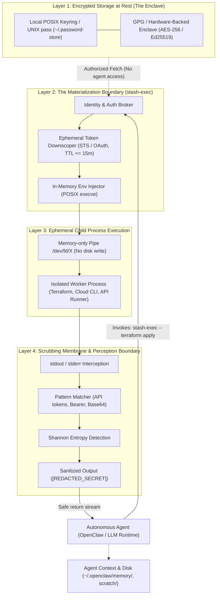
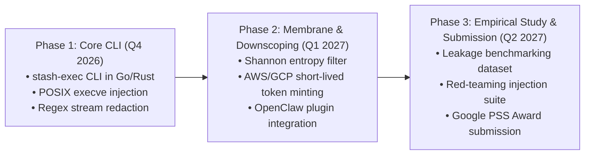

# High-Level Design (HLD) — Project Stash House V2

## Zero-Trust Runtime Credential Containment & The Materialization Boundary for Autonomous Agents

- **Project:** Stash House V2 (`stash-exec`)
- **Version:** 2.0.0
- **Date:** 2026-11-20
- **Author:** Franklin Diaz (`franklin@bitsmasher.net` / `franklin.diaz@ucdenver.edu`)
- **Affiliation:** University of Colorado Denver / Bitsmasher Labs
- **Target Grant Programs:**
  - Google AI for Privacy, Safety & Security (PSS) Award — Primary ($100K)
  - NSF Secure and Trustworthy Cyberspace (SaTC) — Supporting / Infrastructure Core

---

## 1. Executive Summary

Autonomous agentic systems (e.g., OpenClaw, AutoGPT, Claude Code) represent a paradigm shift in software development and systems orchestration. Agents autonomously decompose user instructions, invoke command-line utilities, author scratchpad scripts, inspect cloud topologies, and execute multi-hop infrastructure modifications.

However, current secret management architectures (HashiCorp Vault, OpenBao, 1Password, cloud IAM) are explicitly designed for **human engineers** operating interactive shells or **static microservices** bound to persistent container identities. None of these systems model or mitigate the primary failure mode of autonomous coding agents: **the inadvertent exfiltration of runtime secrets into conversational memory, vector embeddings, reflection loops, and persistent disk traces.**

**Stash House V2** transforms Stash House from a conventional developer password-store wrapper into an **Agentic Runtime Credential Containment System**. By enforcing an in-memory **Materialization Boundary** via a lightweight execution envelope (`stash-exec`) and an output-scrubbing membrane, Stash House guarantees that autonomous agents can utilize live authority (e.g., Terraform, cloud CLIs, API calls) without ever acquiring direct read access to plaintext secrets or persisting sensitive tokens across LLM prompt contexts.

---

## 2. Threat Model: The Agentic Credential Exposure Vectors

In an environment where an autonomous agent operates directly on an engineering workstation (e.g., `chonk.lab.bitsmasher.net`), static key placement (e.g., `.env`, exported environment variables, static configuration files) introduces four severe attack surfaces:

```text
┌─────────────────────────────────────────────────────────────────────────────┐
│                          Agentic Exposure Vectors                           │
├───────────────────────────────┬─────────────────────────────────────────────┤
│ 1. Context Window Ingestion   │ Verbose CLI stack traces (curl, Terraform)  │
│                               │ or raw `env` executions echo plaintext      │
│                               │ credentials directly into the prompt context│
├───────────────────────────────┼─────────────────────────────────────────────┤
│ 2. Memory & Reflection Sprawl │ Ephemeral secrets are committed to daily    │
│                               │ session logs, trajectory databases, and     │
│                               │ vector stores (~/.openclaw/memory/daily/)   │
├───────────────────────────────┼─────────────────────────────────────────────┤
│ 3. Scratchpad Persistence     │ Agents author temporary scripts in scratch/ │
│                               │ or staging/ directories, hardcoding keys or │
│                               │ leaving unencrypted dotenv files on disk    │
├───────────────────────────────┼─────────────────────────────────────────────┤
│ 4. Indirect Prompt Injection  │ Adversarial inputs encountered during web   │
│                               │ ingestion or repo analysis instruct the LLM │
│                               │ to dump environment variables via curl      │
└───────────────────────────────┴─────────────────────────────────────────────┘
```

### Core Invariant

> **The Zero-Agent-Read Principle:** The autonomous agent must never possess the authority to read, display, or inspect plaintext credentials. Authority must be conferred exclusively at the instant of child process execution, restricted to volatile memory, and scrubbed from all return streams.

---

## 3. System Architecture & The 4-Layer Containment Framework

The Stash House V2 architecture consists of four coordinated layers governing credentials across storage, materialization, execution, and output capture.



### Layer 1: Encrypted Storage at Rest (The Enclave)

- **POSIX Primitive Baseline:** Utilizes standard POSIX and Open Source cryptography: UNIX `pass` (`~/.password-store/`) and GnuPG keyrings.
- **Zero Agent Visibility:** File permissions enforce that the agent execution user has no direct decrypt access to master keys without explicit broker mediation.
- **No Static Files:** Forbids plaintext `.env`, `credentials.json`, or exported credentials in user dotfiles.

### Layer 2: The Ephemeral Execution Envelope (`stash-exec`)

`stash-exec` serves as the broker materializing authority dynamically:

1. **Subshell Memory Materialization:** Decrypts secrets strictly into volatile heap memory. Uses `execve` to spawn target child processes with injected environment variables.
2. **Zero Command-Line Leaking:** Prevents exposing secrets via CLI arguments (`--token=XYZ`), ensuring credentials never appear in `ps aux` or procfs tables.
3. **Short-Lived Downscoping:** Where supported (e.g., AWS STS, Google Cloud Service Account impersonation), `stash-exec` exchanges long-term credentials for short-lived tokens (TTL $\le$ 15 minutes) prior to injection.
4. **Shell History Bypassing:** Spawns directly or executes with `set +o history`, guaranteeing zero leakage to `.bash_history`.

### Layer 3: Context Scrubbing Membrane (Stream Sanitization)

The fatal vulnerability of LLM workflows is capturing tool outputs that embed sensitive keys in traces or errors.

- **Stream Interception:** `stash-exec` attaches pseudoterminal (pty) or pipe listeners to child `stdout` and `stderr`.
- **Hybrid Redaction Engine:**
  - *Pattern Matching:* High-confidence regex matching for known secret structures (`AKIA[0-9A-Z]{16}`, GitHub tokens `ghp_`, `gho_`, JWT patterns, PEM blocks).
  - *Entropy Filtering:* Real-time Shannon entropy calculation on alphanumeric blocks ($H > 4.5$) to catch opaque, non-standard API keys.
- **Safe Replacement:** Replaces discovered sensitive sequences with `[REDACTED_SECRET]` before output is returned to the agent's observation window.

### Layer 4: Workspace Isolation & Scratchpad Invariants

- **Deny Persistence Linters:** Workspace integrity hooks abort any agent task attempting to write files matching `*.key`, `*credentials*`, or `.env*` to active scratch directories.
- **Deterministic Teardown:** All child invocations enforce POSIX `trap` cleanup routines, guaranteeing that temporary FIFOs or memory mounts are unlinked on exit.

---

## 4. Google AI for Privacy, Safety & Security (PSS) Alignment

The reframed Stash House architecture directly addresses the core objective of the **Google AI PSS Award: Mitigating Adversarial Usage of AI and Strengthening AI Safeguards**.

### Research Alignment Matrix

| Grant Evaluation Area | Project Stash House V2 Alignment |
| :--- | :--- |
| **Primary Theme** | **Safeguards against Adversarial Usage & Inadvertent Exposure:** Prevents autonomous agents from exfiltrating system authority through prompt injection or uncontrolled trace persistence. |
| **Novelty & White Space** | **First Purpose-Built Agentic Vault:** Conventional vaults manage human identity; Stash House manages LLM perception and execution boundaries. |
| **AI / ML Research Core** | **Adaptive Output Redaction:** Developing lightweight, low-latency entropy and sequence classification models to detect sensitive tokens in unstructured model-tool dialogues. |
| **Open Source Value** | **Production-Ready Open Source Tooling:** Releasing `stash-exec` as a standalone binary and OpenClaw plugin under permissive licensing. |

### Core Research Questions (RQs)

1. **RQ1 (Leakage Modeling):** What is the baseline empirical distribution of credential leakage across popular agent toolsets (bash, file manipulation, cloud CLI) during unconstrained problem-solving?
2. **RQ2 (Membrane Performance):** What are the optimal trade-offs between detection precision/recall and stream latency when running real-time entropy analysis on high-throughput terminal streams?
3. **RQ3 (Downscoped Resilience):** How do multi-hop autonomous planning loops recover when ephemeral credentials expire mid-task, and can autonomous token refresh occur without exposing the master broker?

---

## 5. Implementation Roadmap



### Deliverables

1. **`stash-exec` CLI:** Standalone binary compatible with POSIX Linux and macOS.
2. **Agentic Redaction Membrane:** Standalone Go/Python library for real-time terminal stream secret scrubbing.
3. **Benchmark Trace Suite:** Synthetic and captured evaluation dataset measuring secret leakage rates across agentic workflows.
4. **Grant Whitepaper:** Complete proposal packet formatted for Google AI PSS Award submission.

---

## 6. Document Navigation & Index

- [docs/README.md](file:///home/franklin/Documents/research/stash-house/docs/README.md) — Documentation index and quickstart guide.
- [docs/HLD.md](file:///home/franklin/Documents/research/stash-house/docs/HLD.md) — This document (System High-Level Design).
- [docs/archive/v1-legacy/](file:///home/franklin/Documents/research/stash-house/docs/archive/v1-legacy) — Historical V1 assets (local pass setup, drawio schemas, initial raw notes).
